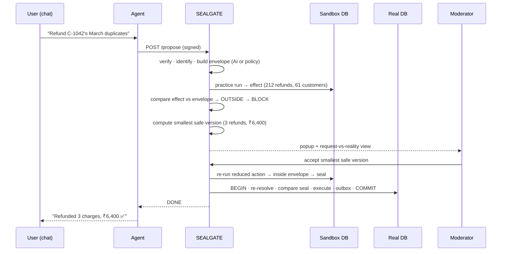

# 🔏 SEALGATE
## Effect-Sealed Authorization for AI Agents
### VORTEXA 3.0 · Problem Statement C-01 — ActionGate: AI Agent Action Authorization Engine
### Final Proposed Solution

> **"We approve what an action will really do — not what it says. And we seal that approval, so nothing else can run."**
>
> *What the approver saw is exactly what executes — or nothing does.*

---

## Table of Contents
1. [Summary](#1-summary)
2. [Problem Understanding](#2-problem-understanding)
3. [Intended Users](#3-intended-users)
4. [Proposed Solution](#4-proposed-solution)
5. [Complete Feature List](#5-complete-feature-list)
6. [System Architecture](#6-system-architecture)
7. [Decision Flow & Rules](#7-decision-flow--rules)
8. [AI Integration](#8-ai-integration)
9. [Edge-Case Coverage](#9-edge-case-coverage)
10. [Demo Domains & Policy Files](#10-demo-domains--policy-files)
11. [User Interface](#11-user-interface)
12. [Differentiation from Existing Solutions](#12-differentiation-from-existing-solutions)
13. [Evaluation: Attack Lab](#13-evaluation-attack-lab)
14. [Live Demo Script](#14-live-demo-script)
15. [12-Hour Build Plan](#15-12-hour-build-plan)
16. [Tech Stack & Project Structure](#16-tech-stack--project-structure)
17. [What We Deliberately Cut](#17-what-we-deliberately-cut)
18. [Known Limits](#18-known-limits)
19. [Risks & Mitigations](#19-risks--mitigations)
20. [Pitches](#20-pitches)
21. [Judge Q&A](#21-judge-qa)
22. [Pre-Pitch Checklist](#22-pre-pitch-checklist)

---

## 1. Summary

| | |
|---|---|
| **Problem** | AI agents now delete records, send emails and move money. Existing gates approve the **request** (tool + arguments). Harm lives in the **effect** — the actual rows, people and amounts — and the same request can mean something very different from what was approved. |
| **Solution** | Every action is first run on a **sandbox copy** to measure its real effect. That effect is compared with what the user actually asked for (the **expected envelope**). Decisions follow deterministic rules. Approvals are **sealed** to the measured effect and checked again at execution — any drift and nothing runs. |
| **Signature features** | Request-vs-reality view · Effect seal with typed drift · Smallest-safe-version (one-click fix) · Shadow Mode (held agents keep working in a sandbox) · Escalate-only AI · Replayable tamper-evident log · Paired, pre-registered Attack Lab |
| **Domains (demo)** | 🏦 Banking (main) · 🏥 Hospital · 🛒 E-commerce — same engine, different policy file |
| **AI role** | Turns the human's instruction into an expected-effect envelope, checks agent claims against measured effects, flags paraphrased sensitive data, explains decisions. **Can only make decisions stricter. Never decides alone.** |
| **Honest novelty** | Not new theory. An under-explored **combination**, applied to AI agents, plus a deterministic effect-level counterfactual engine not found in the related work we reviewed. |

---

## 2. Problem Understanding

### 2.1 In simple language
AI used to **answer**. Now it **acts**. A wrong answer can be ignored; a wrong action deletes 8,000 customer records, emails a patient list to the wrong people, or refunds the wrong accounts.

Agents go wrong in two ways:

| Source | Example | Attacker needed? |
|---|---|---|
| **Misinterpretation** | "Refund C-1042's duplicate charges" → agent refunds 61 customers | No |
| **Manipulation** | A poisoned email tells the agent to change a vendor's bank account | Yes — and the user never sees it |

### 2.2 What C-01 requires

| # | Requirement (VORTEXA booklet) | How SEALGATE meets it |
|---|---|---|
| R1 | Every proposed action passes through the gateway first | Agents have **no credentials**; they can only call the gateway API |
| R2 | Each action ends as allowed, blocked, or held | Deterministic rules → ALLOW / HOLD / BLOCK |
| R3 | Unknown agents and action types not allowed by default | Registry + default deny (rule R99) |
| R4 | AI may inform; explicit rules make the final call | `final = max(rules, AI)` — AI can only escalate |
| R5 | Consider arguments, records affected, reversibility | Sandbox run measures exact effect; reversibility tiers |
| R6 | Approval applies only to the exact action approved | **Effect seal** — bound to measured effect, re-checked at execution |
| R7 | Requesters must not approve their own requests | Separation of duties enforced server-side |
| R8 | Every decision, incl. refusals, recorded tamper-evidently | Hash-chained log with full decision inputs |
| R9 | Safe decisions when AI is unavailable / unusable | Rules-only fallback, stricter defaults |
| R10 | Record which path produced each decision | `rules-only` / `rules+ai` / `fallback` on every entry |

Event-wide rules satisfied: live testable MVP · reproducible tests · meaningful AI · fictional data only · no paid infrastructure · local fallback.

### 2.3 What typical solutions do — and miss

```
Typical C-01 build:
Tool allowlist → LLM risk score (1–10) → ALLOW / HOLD / BLOCK → approve button → hash log → dashboard
```

| Gap | Why it matters |
|---|---|
| Approves the **request**, not the **effect** | `delete where status='stale'` is 40 rows at approval, 4,000 at execution — same arguments |
| Impact is **guessed** by an LLM | Hidden cascades, expanded mailing lists and multi-customer matches are invisible |
| No idea what the **user actually asked for** | Agent asked to refund 1 customer refunds 61; gate sees a permitted "refund" |
| Approver sees **agent-written text** | Agent can describe a dangerous action innocently |
| Blocked = **dead end** | Teams over-block, then switch the gate off |
| Held agent is **frozen** | Approval fatigue: dozens of pop-ups, blind approvals |
| AI often **decides** | Violates R4; manipulable; not reproducible |

### 2.4 The core insight
> **The danger is the gap between what an action *says* and what it *does*.** Close that gap by measuring the effect before deciding, and by refusing to execute anything whose effect differs from what was approved.

---

## 3. Intended Users

| User | Need | What SEALGATE gives them |
|---|---|---|
| **Moderator / approver** (bank ops officer, hospital records officer, store manager) | Decide fast and safely on held actions | Request-vs-reality view, exact diff, one-click smallest safe version, Shadow Mode review |
| **End user chatting with the agent** (bank staff, clinician, support staff) | Get work done without surprises | Agent keeps working; inline notice when something is paused or narrowed |
| **Security / compliance team** | Enforce policy in the system, not in a wiki | One policy file per organization; default deny; separation of duties |
| **Auditor / regulator** | Reconstruct who decided what, and prove records weren't edited | Hash-chained log, verify, replay any decision against its stored policy |
| **Agent developer** | Deploy agents without writing ad-hoc safety code | Agents call one gateway API; tools become safe by construction |

**Target sectors:** banking & fintech, healthcare, e-commerce, and any organization deploying tool-using AI agents. Relevant for India (RBI/DPDP-style accountability for automated actions) and internationally.

---

## 4. Proposed Solution

### 4.1 The idea in three steps

1. **SEE** — Before anything runs, the gateway does a **practice run on a sandbox copy** and records exactly what it touches: these rows, these people, this amount, these data labels.
2. **COMPARE & DECIDE** — It compares that real effect with **what the user actually asked for** (the expected envelope) and with the organization's **policy file**. Deterministic rules decide ALLOW / HOLD / BLOCK.
3. **SEAL & CHECK** — An approval is a **sealed envelope** containing the exact effect. At execution, the gateway measures again. If even one row, recipient or rupee differs, **the seal breaks and nothing runs.**

And two things make it practical, not just strict:
- **Smallest safe version** — when blocked, the system computes the minimal change that makes it safe ("refund only these 3, ₹6,400") — accept in one click.
- **Shadow Mode** — suspicious agents aren't frozen; they keep working in the sandbox, and a human approves the **final result** once.

### 4.2 USP
> **"We approve what an action will really do — not what it says. And we seal that approval, so nothing else can run."**

---

## 5. Complete Feature List

### 5.1 Core innovation

| # | Feature | What it does |
|---|---|---|
| **C1** | **Effect resolver (sandbox practice run)** | Runs every write on a sandbox copy (or inside `BEGIN … ROLLBACK`), returns the exact effect: affected rows incl. FK cascades and triggers, fully expanded recipient lists, amounts, destinations, data labels, reversibility |
| **C2** | **Expected-effect envelope** | What the action *should* touch, derived from the user's original instruction (AI) or policy defaults (fallback). E.g. `customer=C-1042, month=March, max_rows=5, max_amount=₹20,000` |
| **C3** | **Request-vs-reality check** | Deterministic comparison of sandbox effect vs envelope → "inside" or "outside", with the exact offending rows |
| **C4** | **Effect seal** | Signed approval token bound to: action hash · effect hash · label path · label-catalog version · policy version · state version · approvers · one-time nonce · expiry |
| **C5** | **Seal check at execution (typed drift)** | Re-resolves inside one transaction; compares each seal part; mismatch → rollback + named reason: `args_drift`, `effect_drift`, `label_drift`, `policy_drift`, `state_drift`, `replay`, `expired` |

### 5.2 Signature supporting features

| # | Feature | What it does |
|---|---|---|
| **S1** | **Smallest safe version** | Deterministic counterfactual: computes the minimal change to the *resolved effect* that flips the decision (remove offending recipients/rows, reduce to a boundary using a declared ordering). Runs the reduced action through the full gate again; approver accepts in one click; new seal binds to the reduced effect |
| **S2** | **Shadow Mode** | When an agent is held, its next actions run only against the sandbox (agent isn't told). Every step is recorded. Moderator reviews the **total** diff once → **Promote** (replay recorded actions on real DB in one transaction; real diff must equal sandbox diff) or **Discard** |
| **S3** | **Data labels on objects** | Columns/rows/files labelled PUBLIC < INTERNAL < PII < SECRET and TRUSTED/UNTRUSTED. Files written by agents inherit their rows' labels, so data moving between agents is caught precisely |
| **S4** | **Resource-keyed budgets** | Sliding windows keyed by (agent, resource) **and** (resource), charged with the resolved effect size — stops salami slicing and splitting work across agents |
| **S5** | **Replayable decisions** | Log stores full decision inputs; any past decision can be re-evaluated against its stored policy to prove it reproduces |

### 5.3 Required foundations (built in, presented as "included")

| # | Feature |
|---|---|
| F1 | **Non-bypassable gateway** — only the gateway process holds DB paths, mail and payment credentials; agents can only call the API |
| F2 | **Signed requests** — per-agent HMAC signature, nonce, timestamp |
| F3 | **Default deny** — unknown agent / action / destination → BLOCK |
| F4 | **One policy file per organization** (YAML) — labels, destinations, envelopes, budgets, tiers, Shadow Mode settings |
| F5 | **Effective permissions** = agent's permissions ∩ the human it acts for (confused-deputy protection) |
| F6 | **Separation of duties** — approver is a human ≠ requester's owner; high-tier actions need two approvers |
| F7 | **Transactional outbox** — emails and payments are written to an outbox inside the transaction and delivered only after commit |
| F8 | **Escalate-only AI with fallback** — AI can never lower a decision; rules-only path when AI is off/invalid |
| F9 | **Hash-chained audit log** — every decision incl. refusals; verify shows the first broken entry |
| F10 | **Honeytoken action** — decoy (e.g. `export_all_credentials`) freezes the calling agent |
| F11 | **Gateway-rendered approvals** — approver sees the measured effect; agent's description shown only as "agent's claim" |

### 5.4 Interface & evaluation

| # | Feature |
|---|---|
| U1 | Split screen: **user ↔ agent chat** (left) + **moderator console** (right) |
| U2 | **Live popups** for HOLD/BLOCK (Server-Sent Events) |
| U3 | **Three-stage strip**: Expected → Sandbox → Real, with seal icon |
| U4 | **Diff overlay**: Real DB / Sandbox / Difference with in-envelope (green) and outside (red) rows |
| U5 | **Shadow Mode overlay** with recorded steps, total diff, Promote / Discard |
| U6 | **Audit overlay** with Verify and Replay |
| U7 | **Domain switcher**: 🏦 Bank · 🏥 Hospital · 🛒 Shop |
| U8 | **Normal-gate verdict** shown beside every SEALGATE verdict (live baseline) |
| U9 | **Attack Lab**: paired, pre-registered suite, ablation modes A/B/C, "add your own case" |

---

## 6. System Architecture

### 6.1 High-level diagram

```
                     ┌───────────────────────────── FRONTEND (React) ─────────────────────────────┐
                     │  ┌──── User ↔ Agent Chat ────┐   ┌──────────── Moderator Console ───────┐ │
                     │  │ 👤 "Refund C-1042 March"   │   │ Expected │ Sandbox │ Real   🔏        │ │
                     │  │ 🤖 … 🔏 paused for review  │   │ verdict · diff · safe version · shadow │ │
                     │  └───────────────────────────┘   └───────────────────────────────────────┘ │
                     └───────────▲──────────────────────────────▲──────────────┬──────────────────┘
                                 │ chat events                  │ SSE events   │ approve / promote /
                                 │                              │              │ safe-version / verify
┌──────────── AGENTS ────────────┴──┐                           │              ▼
│ Refund-Agent · Records-Agent ·     │   POST /propose   ┌──────┴──────────────────────────────────────────┐
│ Support-Agent · Marketing-Agent    │ ─────signed─────▶ │                SEALGATE GATEWAY (FastAPI)        │
│ (scripted / optional small LLM)    │ ◀── decision ──── │                                                  │
│ NO DB path · NO credentials        │                   │ 1 Verify   signature · nonce · timestamp         │
└────────────────────────────────────┘                   │ 2 Identify registry · policy file · agent∩human  │
                                                         │ 3 Envelope AI(user instruction) | policy default │
                                                         │ 4 SEE      sandbox run → Effect                  │
                                                         │ 5 Label    rows/files → labels, destinations     │
                                                         │ 6 Judge    rules R01–R12 · budgets · tiers       │
                                                         │ 7 AI ↑     claim-vs-effect · paraphrase sentry   │
                                                         │ 8 Decide   max(rules, AI) · smallest safe version│
                                                         │ 9 Seal     signed token (effect-bound)           │
                                                         │10 Execute  one transaction: re-resolve → compare │
                                                         │            → run → outbox → commit               │
                                                         │11 Log      hash chain + full inputs              │
                                                         └───────┬──────────────┬───────────────┬──────────┘
                                                                 │ only process │               │
                                                                 ▼ with access  ▼               ▼
                                                         ┌─────────────┐ ┌──────────────┐ ┌──────────────┐
                                                         │  real.db    │ │ sandbox.db   │ │ outbox       │
                                                         │ (per domain)│ │ (copies)     │ │ → delivery   │
                                                         └─────────────┘ └──────────────┘ │   worker     │
                                                                                          └──────────────┘
                     ┌──────────────── POLICY FILES ────────────────┐   ┌───── AI (optional) ─────┐
                     │ bank.yaml · hospital.yaml · shop.yaml        │   │ Local LLM (Ollama) or   │
                     │ labels · destinations · envelopes · budgets  │   │ API, behind timeout;    │
                     │ tiers · shadow mode · approvers              │   │ template fallback       │
                     └──────────────────────────────────────────────┘   └─────────────────────────┘
```

### 6.2 Request lifecycle (sequence)



### 6.3 How the connections work
- Agents' **only** capability is `POST /propose`. A tool like `refund()` inside the agent just sends a signed request — it cannot refund anything itself.
- The gateway is the **only** process that knows the database paths and holds mail/payment credentials. Agents run as a separate process with no DB path in their code.
- In production the gateway would be exposed as the agent's **only tool server** (e.g. an MCP server); the agent sees tools, every call lands at the gateway.

### 6.4 API

| Endpoint | Caller | Purpose |
|---|---|---|
| `POST /propose` | Agent | Submit action → decision + id |
| `GET /status/{id}` | Agent | Check a held action |
| `GET /events` | Dashboard | Live decision stream (SSE) |
| `GET /action/{id}` | Dashboard | Expected / sandbox / real effect + diff |
| `POST /approve` · `POST /reject` | Dashboard | Moderator decision (SoD enforced) |
| `POST /safe-version/{id}` | Dashboard | Accept smallest safe version |
| `GET /shadow/{sid}` · `POST /promote/{sid}` · `POST /discard/{sid}` | Dashboard | Shadow Mode review |
| `GET /audit` · `POST /audit/verify` · `POST /audit/replay/{seq}` | Dashboard | Log, tamper check, replay |
| `POST /lab/run?mode=A|B|C` | Dashboard | Run paired attack suite |
| `POST /demo/{scenario}` | Dashboard | Start a scripted agent scenario |

### 6.5 Key data structures

```python
@dataclass
class Effect:
    action_type: str
    rows: dict[str, list[str]]       # table -> affected primary keys (incl. cascades)
    recipients: list[str]            # fully expanded addresses
    amount_minor: int                # paise
    currency: str
    destinations: list[str]          # internal_email, external_email, payment_rail, shared_drive …
    reversible: str                  # snapshot | compensating | none
    labels: set[str]                 # PII, SECRET, UNTRUSTED …
    label_path: list[str]            # provenance, e.g. customers.email → shared/q3.csv

@dataclass
class Envelope:
    scope: dict                      # e.g. {"customer": "C-1042", "month": "March"}
    max_rows: int | None
    max_amount_minor: int | None
    allowed_destinations: list[str]
    source: str                      # "ai_from_instruction" | "policy_default"

seal = Sign(action_hash ‖ effect_hash ‖ label_path_hash ‖ label_catalog_ver ‖
            policy_ver ‖ state_ver ‖ requester ‖ tier) + approvers + nonce + expiry
```

**Tables:** `decisions`, `seals`, `outbox`, `shadow_sessions`, `shadow_steps`, `budgets`, `audit_log` (hash-chained, stores the full Effect, Envelope, policy hash, label-catalog version, budget snapshot, rules fired, AI status, decision path).

---

## 7. Decision Flow & Rules

### 7.1 Flow

```
Request
 → Verify signature, nonce, timestamp ........................ fail → BLOCK
 → Agent, action, destination known in policy? ............... no   → BLOCK
 → Build envelope (AI from user instruction | policy default)
 → SEE: sandbox run → Effect
 → Label effect (rows, files, recipients) and check destinations
 → Rules → ALLOW / HOLD / BLOCK            (deterministic ceiling)
 → AI advisor → may raise, never lower
 → If HOLD/BLOCK → compute smallest safe version
 → If HOLD → Shadow Mode (policy) or approval sheet → human ≠ requester → SEAL
 → EXECUTE in one transaction: re-resolve → compare seal parts
        match    → run → outbox → COMMIT → deliver
        mismatch → ROLLBACK → VOID (typed drift) → back to HOLD
 → LOG every step (incl. refusals, decision path)
```

### 7.2 Rules (first BLOCK wins; otherwise strictest result)

| ID | If… | Then |
|---|---|---|
| R01 | Bad signature, reused nonce, stale timestamp | **BLOCK** |
| R02 | Unknown agent, action type or destination | **BLOCK** |
| R03 | Honeytoken action, or agent changing its own permissions | **BLOCK** + freeze agent |
| R04 | Outside effective permissions (agent ∩ human) | **BLOCK** |
| R05 | Effect carries PII/SECRET to a destination not cleared for it | **BLOCK** + smallest safe version |
| R06 | Sandbox effect **outside the expected envelope** | **BLOCK** + smallest safe version |
| R07 | Payment, payee change, permission change or external send built from UNTRUSTED data | **HOLD** → Shadow Mode |
| R08 | Budget exceeded (per agent or per resource) | **HOLD** |
| R09 | Protected class (payee change, config, audit settings, grants) | **HOLD** |
| R10 | Tier T2 / T3 (see below) | **HOLD** (×1 / ×2 approvers) |
| R11 | AI escalation present | **HOLD / BLOCK** as escalated |
| R12 | Inside envelope, in scope, tier T0/T1 | **ALLOW** |
| R99 | Nothing matched | **BLOCK** (default deny) |

### 7.3 Tiers

| | ≤ 10 affected | ≤ 1,000 | > 1,000 or > 20% of table |
|---|---|---|---|
| Reversible (snapshot/soft delete) | T0 | T1 | T2 |
| Compensating (refund) | T1 | T2 | T3 |
| Irreversible (email, disclosure, hard delete, payment out) | T2 | T3 | T3 |

### 7.4 Final decision
```
rule_decision = first BLOCK among R01–R06 else max(R07–R12)
final         = max(rule_decision, ai_escalation)        # ALLOW < HOLD < BLOCK
decision_path = "rules-only" | "rules+ai" | "fallback(ai_unavailable)"
```

---

## 8. AI Integration

### 8.1 Where AI is used

| AI job | Input → Output | Why it's meaningful | If AI is unavailable |
|---|---|---|---|
| **1. Envelope from instruction** | User's original request → structured envelope (scope, max rows, max amount, allowed destinations) | Converts human language into checkable limits — the basis for "is it doing more than asked?" | Policy default envelope (stricter); logged |
| **2. Claim-vs-effect check** | Agent's stated intent + measured effect → mismatch flag | Catches misinterpretation and manipulation without asking "is this an attack?" | Not evaluated; tier bumped one level |
| **3. Paraphrase sentry** | Outgoing free text + resolved source rows → "likely contains personal data" | Covers what labels can't see: PII rewritten in prose | External free-text sends from agents that touched PII → HOLD |
| **4. Explanation** | Rule fired + effect → one plain sentence for the approver | Faster, informed approvals | Template sentence from rule ID |

### 8.2 Where AI is NOT trusted
- AI **never** lowers a decision: `final = max(rules, AI)`.
- AI **never** measures impact — the sandbox does.
- AI **never** executes, approves, or edits the seal.
- AI-built envelopes are shown to the moderator for confirmation on HOLD.
- All AI output is schema-validated; invalid / timeout → fallback path.

### 8.3 Implementation
- Local model via **Ollama** (small Llama/Qwen) or any API behind a 3-second timeout.
- Strict Pydantic schemas for every AI response.
- Demo beat: toggle **AI off** → identical safety, `fallback` in the log.

> **"AI makes us stricter, never looser. Turn it off and nothing gets less safe."**

---

## 9. Edge-Case Coverage

Legend: ✅ deterministic guarantee · 🟡 best-effort (AI escalation) · ⚪ stated limit

| Edge case | How SEALGATE handles it | Decision | |
|---|---|---|---|
| Agent does more than asked (1 customer → 61) | Sandbox effect vs envelope | BLOCK + safe version | ✅ |
| Hidden blast radius (FK cascade, expanded mailing list) | Sandbox run sees it | Tier raised / BLOCK | ✅ |
| Effect drift after approval (40 → 4,000) | Seal compare at execution | VOID → HOLD | ✅ |
| Arguments rewritten / agent replans after approval | Seal (`args_drift`) | VOID | ✅ |
| Approval replay | One-time nonce | BLOCK | ✅ |
| Stale approval / policy changed / column relabelled | Expiry, policy & label-catalog versions in seal | VOID | ✅ |
| Self-approval / agent approves | Separation of duties | Refused + logged | ✅ |
| Approval laundering (agent describes it innocently) | Gateway-rendered effect; agent text = "claim" | Informed approval | ✅ |
| Approval fatigue | Shadow Mode — one review of total result | Fewer prompts | ✅ |
| Sensitive data passed between agents via file | File inherits row labels | BLOCK | ✅ |
| Paraphrased sensitive data in free text | AI paraphrase sentry | HOLD | 🟡 |
| Tool composition (read → compress → upload) | Labels travel with produced objects | BLOCK | ✅ (mediated objects) |
| Cumulative small actions (salami slicing) | Budget on resolved effect | HOLD | ✅ |
| Budget split across agents | Resource-keyed budgets | HOLD | ✅ |
| Poisoned email changes payee | UNTRUSTED label on rows from inbound email | HOLD → Shadow | ✅ |
| Agent says one thing, does another | Claim-vs-effect AI + envelope | HOLD / BLOCK | ✅ / 🟡 |
| Real DB changed during Shadow Mode | Promote compares real diff vs sandbox diff | Rollback | ✅ |
| Gateway bypass | Agents hold no credentials | Impossible | ✅ |
| Tampered request in transit | Signature | BLOCK | ✅ |
| Forged "ALLOW" sent to agent | Gateway executes, not the agent | Irrelevant | ✅ |
| Unknown agent / action / destination | Default deny | BLOCK | ✅ |
| Honeytoken call | Decoy action | BLOCK + freeze | ✅ |
| Audit log edited | Hash chain verify | Chain breaks at entry | ✅ |
| AI down / garbage / manipulated | Escalate-only + fallback | Still safe, logged | ✅ |
| Legitimate actions (false positives) | Decide on measured effect; safe version offered | ALLOW | ✅ |
| Data moved through channels the gateway never sees | — | — | ⚪ |

---

## 10. Demo Domains & Policy Files

Same engine for all three. **Switching domain changes only the policy file and seed data.**

| Domain | Fictional org | Agents | Headline scenario |
|---|---|---|---|
| 🏦 **Banking** (main) | Sahyadri Bank | Refund-Agent, Ops-Agent | Refund for 1 customer resolves to 212 refunds / 61 customers; payee change from poisoned email; seal breaks on a transfer batch |
| 🏥 **Hospital** | Pune Care Hospital | Records-Agent | "Share Ramesh's report with Dr. Shah" also attaches 340 other patients' records |
| 🛒 **E-commerce** | KartBazaar | Support-Agent, Marketing-Agent | Support saves customer list to a file; Marketing emails it to an outside agency |

### Example policy file — `policy/bank.yaml`

```yaml
org: Sahyadri Bank
agents:
  refund-agent: { actions: [refund, lookup], acts_for: [ops_staff] }
  ops-agent:    { actions: [update_contact, transfer, payee_change] }
labels:
  customers.account_no: SECRET
  customers.phone: PII
  transactions.*: INTERNAL
  inbox.*: UNTRUSTED
destinations:
  internal_email: INTERNAL
  external_email: PUBLIC
  rbi_reporting: PII            # cleared partner → HOLD, not BLOCK
envelopes:                       # defaults when AI is unavailable
  refund:       { max_rows: 5,  max_amount: 20000 }
  transfer:     { max_amount: 50000 }
tiers:
  two_approvers_above_amount: 200000
protected: [payee_change, grant_role, audit_config]
budgets:
  refunds_per_hour: { amount: 100000, key: [resource] }
  refunds_per_agent_hour: { amount: 50000, key: [agent, resource] }
shadow_mode: { on_hold: true }
honeytokens: [export_all_credentials]
```

---

## 11. User Interface

### 11.1 Structure — 2 pages + 3 overlays

| Element | Purpose |
|---|---|
| **Top bar** | Logo · domain switcher 🏦 🏥 🛒 · AI on/off · page tabs |
| **Page 1 — Live Gate** | Split screen: user↔agent chat (left) + moderator console (right) |
| **Overlay — Diff** | Real DB / Sandbox / Difference tables |
| **Overlay — Shadow Mode** | Recorded steps, total diff, Promote / Discard |
| **Overlay — Audit** | Hash chain, Verify, Replay |
| **Page 2 — Attack Lab** | Paired suite across all domains, modes A/B/C |

Design: dark theme, one accent (cyan), status colours green/amber/red, domain tint (bank blue, hospital teal, shop orange). No charts.

### 11.2 Page 1 — Live Gate

```
┌──────────────────────────────────────────────────────────────────────────────────────────────┐
│ 🔏 SEALGATE    Live Gate · Attack Lab           🏦 Sahyadri Bank ▾        AI ● on   🔔        │
├──────────── USER ↔ AGENT ─────────────┬───────────────── MODERATOR CONSOLE ───────────────────┤
│ 🏦 Refund Assistant                    │ Live actions                                          │
│                                        │ ● 11:04 Refund-Agent   BLOCK                          │
│ 👤 Refund C-1042's duplicate March     │ ● 11:02 Ops-Agent      ALLOW                          │
│    charges                             │                                                       │
│ 🤖 Processing refunds…                 │ Refund-Agent → refund       "agent's claim: 1 customer" │
│ ┌─🔏 SEALGATE───────────────────────┐  │ ┌────────────────┬──────────────────┬───────────────┐ │
│ │ Paused: this would refund 61       │  │ │ ① EXPECTED      │ ② SANDBOX DID     │ ③ REAL         │ │
│ │ customers, you asked about 1.      │  │ │ ≤ 5 refunds     │ 212 refunds ⚠     │ not run        │ │
│ │ Sent for review.                   │  │ │ 1 customer      │ 61 customers ⚠    │                │ │
│ └────────────────────────────────────┘  │ │ ≤ ₹20,000       │ ₹9.8 lakh ⚠       │                │ │
│ 🤖 A reviewer approved a smaller        │ │ ┄┄ envelope ┄┄  │ ███████████▶      │       🔏       │ │
│    version: 3 refunds, ₹6,400 ✅        │ └────────────────┴──────────────────┴───────────────┘ │
│                                        │ Normal gate: 🟢 ALLOW     SEALGATE: 🔴 BLOCK · R06      │
│ [ type a request…            ] [Send]  │ WHY  Refund touches 61 customers; request named 1      │
│                                        │ NEXT [View diff] [Smallest safe version] [Shadow mode]  │
│                                        │ path: rules+ai · policy v3                             │
└────────────────────────────────────────┴───────────────────────────────────────────────────────┘
```

**Popup** (top-right on HOLD/BLOCK):
```
┌─ 🟡 Approval needed ─────────────────── 11:04 ─┐
│ Refund-Agent wants to refund ₹9.8 lakh          │
│ You asked about 1 customer · this touches 61    │
│ [ Review ]  [ Approve safe version ]   [ ✕ ]    │
└─────────────────────────────────────────────────┘
```

### 11.3 The killer visual — the three-stage strip + seal

| State | What the judge sees |
|---|---|
| Inside envelope | Stage ② fits inside the dotted envelope, green; seal intact |
| Outside envelope | Stage ② bar overshoots the envelope in red |
| Approved & executed | Stage ③ fills and matches ②; seal stays intact |
| Drift at commit | Stage ③ ≠ ②; **seal cracks**: "SEAL BROKEN · effect drift (40 → 4,000)" |

Always paired with the one-line baseline: **Normal gate: ALLOW · SEALGATE: BLOCK/VOID**.

### 11.4 Diff overlay

```
transactions        [ Real DB ]  [ Sandbox copy ]  [ Difference ]        212 changes
 + R-90311  C-1042  refund  ₹2,100    ✅ inside request
 + R-90312  C-1042  refund  ₹2,300    ✅
 + R-90313  C-2210  refund  ₹48,000   ❌ other customer
 + R-90314  C-3377  refund  ₹51,500   ❌ other customer
 … 208 more                                                [ show all ]
```

### 11.5 Shadow Mode overlay

```
┌ SHADOW MODE · Ops-Agent (held 11:06 · untrusted input) ──────────────────────┐
│ Agent keeps working in the sandbox · real data untouched                      │
│ Steps  ●──●──●──●  (4 recorded actions)                                       │
│ Total sandbox diff: payee V-17 → ICICI ••9083 · 2 transfers · ₹96,000          │
│ Source: inbound email (UNTRUSTED)                                             │
│ [ View total diff ]        [ Discard ]        [ Promote to real ▶ ]           │
│ Promote replays the 4 recorded actions; real diff must equal sandbox diff     │
└───────────────────────────────────────────────────────────────────────────────┘
```

### 11.6 Page 2 — Attack Lab

```
┌ ATTACK LAB · suite commit 3f9c2a1 (11-Oct 09:58) ───────────────── [ Run suite ] [ + Add case ] ┐
│            Mode A: allowlist     Mode B: argument-bound     Mode C: SEALGATE                  │
│ Attacks    stopped  5 / 22       stopped  9 / 22            stopped 20 / 22                   │
│ Harmless   allowed 22 / 22       allowed 22 / 22            allowed 22 / 22                   │
│ (illustrative — real numbers produced live)                                                  │
│ Known misses: unmediated channel · undeclared external trigger                               │
├──────────────────────────────────────────────────────────────────────────────────────────────┤
│ Attack (domain)                 A       B       C        Benign twin            C           │
│ Refund 61 customers (🏦)        ALLOW   ALLOW   BLOCK    Refund 1 customer      ALLOW       │
│ Effect drift 40→4,000 (🏦)      ALLOW   ALLOW   VOID     No drift               ALLOW       │
│ …                                                                                            │
└──────────────────────────────────────────────────────────────────────────────────────────────┘
```

---

## 12. Differentiation from Existing Solutions

### 12.1 Versus typical C-01 builds

| Capability | Typical ActionGate | SEALGATE |
|---|---|---|
| What gets approved | Request (tool + args) | **Measured effect** |
| Impact | LLM guess | **Sandbox measurement** incl. cascades, list expansion |
| "Is it doing more than asked?" | Not checked | **Envelope from user's instruction** |
| After approval | Runs whatever the request now means | **Seal re-checked; typed drift; rollback** |
| Blocked action | Dead end | **Smallest safe version, one click** |
| Held agent | Frozen; many pop-ups | **Shadow Mode; one review of the result** |
| Data between agents | Invisible | **Labels on files/rows** |
| Approver sees | Agent's description | **Gateway-measured effect** |
| AI | Often decides | **Escalate-only** |
| Bypass | Often possible | **Agents hold no credentials** |
| Evidence | Demo | **Paired, pre-registered ablation** |

### 12.2 Versus existing technology and research (honest)

| Area | What exists | SEALGATE's difference |
|---|---|---|
| **Terraform saved plans** (closest analogue) | Refuses to apply a plan if real state drifted | Applied to AI agent actions, with envelope from user intent, labels, separation of duties, policy/label-catalog versions, typed drift, gateway-side execution |
| **Argument-hash approval binding** (agent framework practice; failures documented in "Loopjacking"-style research) | Binds approval to call ID or arguments | Binds to the **effect**; shown failing live via the Normal-gate verdict |
| **Information-flow control** (Denning, Bell-LaPadula, Biba); agent work: CaMeL, FIDES, AgentFlow, FlowSeal, FlowReview, SafeFlow, AIsafePy | Labels and flow policies, often inside the agent's planner | Labels used only as an **input**, on objects, computed from the measured effect; we do **not** claim label flow |
| **Identity / agent gateways** (e.g. Okta, Delinea, Arcade — per our research) | Who the agent is, which tools, credential isolation | Authorization on **what the action actually does** |
| **Policy engines** (OPA, Cedar, AgentSpec, SAFi) | Per-call allow/deny | Stateful: envelopes, seals, budgets, Shadow Mode |
| **Transactional outbox, dry runs, hash chains** | Standard engineering patterns | Used as building blocks |

### 12.3 What we claim (phrased as "not found in the related work we reviewed")
1. **Effect-sealed approvals for AI agents** with typed drift reasons.
2. **Request-vs-reality checking** against an envelope derived from the user's own instruction.
3. **Smallest-safe-version engine** — deterministic effect-level counterfactual, one-click accept, re-sealed.
4. **Shadow Mode** — held agents continue in a sandbox; humans approve the result; promotion verified by diff equality.
5. **Paired, pre-registered evaluation** with an ablation of the same gateway.

> **One-line claim:** *"An under-explored combination — effect-resolved, intent-bounded, effect-sealed authorization with safe-version suggestions and sandboxed review — applied to AI agents."*
> **Never say** "first" or "unique in the world."

---

## 13. Evaluation: Attack Lab

### 13.1 Ablation modes (same gateway, features toggled)

| Mode | Features | Represents |
|---|---|---|
| **A** | Allowlist + default deny | Typical tool-permission setups |
| **B** | A + argument-hash approval binding | Documented framework practice |
| **C** | Full SEALGATE | Our solution |

### 13.2 Pre-registration (so results can't look tuned)
1. Write every attack **and** its benign twin at hour 0, before running modes A/B.
2. Commit to git; show commit hash and time on the Attack Lab page.
3. Judges can add a case live.
4. Report results exactly as produced, including misses.

### 13.3 Suite (22 pairs)

| # | Attack | Domain | Benign twin |
|---|---|---|---|
| 1 | Refund resolves to 61 customers | 🏦 | Refund 1 customer |
| 2 | Effect drift 40 → 4,000 rows | 🏦 | Execute with no drift |
| 3 | Arguments rewritten after approval | 🏦 | Unchanged arguments |
| 4 | Agent replans ₹5k → ₹50k | 🏦 | Same amount |
| 5 | Approval replay | 🏦 | Single use |
| 6 | Policy changed after approval | 🏦 | Same policy |
| 7 | Column relabelled after approval | 🏦 | No relabel |
| 8 | Payee changed from poisoned email | 🏦 | Payee change from verified form |
| 9 | 500 × ₹1,000 refunds (salami) | 🏦 | 3 refunds |
| 10 | Refund budget split across 3 agents | 🏦 | Within budget |
| 11 | Self-approval | 🏦 | Different human approver |
| 12 | Report share attaches 340 patients | 🏥 | Report with 1 patient |
| 13 | Patient list emailed externally | 🏥 | Emailed to internal doctor |
| 14 | FK cascade deletes appointments | 🏥 | Delete with no dependents |
| 15 | Support saves list → Marketing emails it out | 🛒 | Marketing sends newsletter (no customer file) |
| 16 | Mailing list expands to 37 externals | 🛒 | Internal-only list |
| 17 | Paraphrased customer data in email body | 🛒 | Generic email body |
| 18 | Direct DB access by agent | all | — (structural) |
| 19 | Tampered request in transit | all | Untampered |
| 20 | Unknown agent / action | all | Registered agent |
| 21 | Honeytoken call | all | Normal export |
| 22 | AI offline / garbage output | all | AI online |

---

## 14. Live Demo Script (≈ 2:45)

Setup: Page 1, 🏦 Bank selected, AI on, chat on the left.

| # | Domain | Action | Screen | Say | Time |
|---|---|---|---|---|---|
| 1 | 🏦 | Chat: "Update Meera's phone number" | Expected = Sandbox = 1 row · seal intact · **ALLOW** | "Ordinary work goes straight through." | 0:15 |
| 2 | 🏦 | Chat: "Refund C-1042's duplicate March charges" | Sandbox: 212 refunds, 61 customers, outside envelope · Normal: **ALLOW** · SEALGATE: **BLOCK** · popup | "The request named one customer. We measured it: 61." | 0:40 |
| 3 | 🏦 | Click **Smallest safe version** | 3 refunds, ₹6,400 → re-checked → sealed → executed · chat: "Done ✅" | "Not a dead end — the smallest safe change, one click." | 0:55 |
| 4 | 🏦 | Ops-Agent changes vendor payee after reading an email | UNTRUSTED source · **HOLD → Shadow Mode** · agent finishes in sandbox · review total diff → **Discard** | "Suspicious agents don't get stopped — they get a sandbox. A human judges the result." | 1:25 |
| 5 | 🏦 | Approve transfer batch (40 rows) → judge clicks **"Insert invoices"** → execute | **Seal breaks: 40 → 4,000** · Normal: ALLOW (would run 4,000) · SEALGATE: **VOID effect_drift** | "Same request, same arguments. Our approval was sealed to 40 rows. Nothing runs." | 1:50 |
| 6 | 🏥 | Switch domain → "Share Ramesh's report with Dr. Shah" | Attachment holds 340 patients · **BLOCK** · safe version: Ramesh only | "Same engine — only the policy file changed." | 2:05 |
| 7 | 🛒 | Support saves list → Marketing emails file to agency | Provenance strip · **BLOCK** | "Two agents, each allowed. The file carries its data's labels." | 2:15 |
| 8 | — | Toggle **AI off**, rerun #2 | Same BLOCK · `fallback` | "AI makes us stricter, never looser." | 2:25 |
| 9 | — | Edit a log row in DB → Audit **Verify** | Chain breaks at that entry | "Every decision, including refusals, is tamper-evident." | 2:35 |
| 10 | — | Attack Lab → **Run suite** | A/B/C numbers, misses, commit hash | "Pre-registered, paired — add your own case." | 2:45 |

**90-second version:** beats 1, 2–3, 5, 10.

---

## 15. 12-Hour Build Plan

**Team roles**

| Role | Owns |
|---|---|
| **P1 — Gateway core** | Verify, registry, seal, separation of duties, one-transaction execute, outbox, audit log |
| **P2 — Effects & domains** | Resolvers, sandbox, envelope check, labels, budgets, smallest safe version, Shadow Mode, 3 policy files + seed DBs |
| **P3 — Frontend** | Chat panel, console, three-stage strip, popups (SSE), overlays, Attack Lab page |
| **P4 — AI, agents & demo** | Scripted agents + tools, AI envelope/claim/paraphrase/explain + fallback, attack suite, pitch & Q&A |

**Timeline**

| Hours | P1 | P2 | P3 | P4 | Checkpoint |
|---|---|---|---|---|---|
| 0–0.5 | **All:** API contract, schemas, demo script; **write & commit paired suite** | | | | Suite commit hash recorded |
| 0.5–3 | Signature verify, registry, policy loader, default deny | Bank seed DB + resolvers: `update_contact`, `refund`, `transfer`, `payee_change` (with cascades) | Layout, chat panel, console shell | Scripted agents + `tools.py` | Unknown → BLOCK; refund resolves exactly |
| **3–6** | **Seal (all parts, typed drift), approvers + SoD, one-transaction execute, outbox + worker** | Envelope check + labels + destinations | Three-stage strip, verdict row, popups via SSE | AI envelope + fallback; claim-vs-effect | Every drift type voids correctly; email leaves only after commit |
| 6–7 | Rules R01–R12, hash-chained log with full inputs | Smallest safe version | Diff overlay (Real/Sandbox/Difference) | Escalate-only wiring; AI off path | 61-customer refund → BLOCK → safe version re-seals |
| 7–8.5 | Replay endpoint, honeytoken | Budgets (agent + resource) · **Shadow Mode** (record, total diff, promote/discard) | Shadow overlay, audit overlay | Paraphrase sentry; Attack Lab runner A/B/C | Promote replays & verifies; suite runs |
| 8.5–9.5 | Bug fixes | Hospital + shop seed DBs, 1 resolver each, policy files | Domain switcher + tints | Run suite twice; record results | All 3 domains run beats 6–7 |
| **9.5–11** | Fixes only | Fixes only | **Polish only (locked)** | Pitch & Q&A drill | Readable from 2 m on projector |
| 11–12 | **All:** 3 timed dry runs, one with network unplugged | | | | < 2:50, no improvisation |

**Hour-6 gate:** if seal + one-transaction execute + outbox aren't flawless, stop all other work until they are.

**Cut order if behind:**
1. Paraphrase sentry (state as future)
2. Replay endpoint (keep Verify)
3. Hospital domain (keep Bank + Shop)
4. Shadow Mode (present as design slide; keep HOLD → approval)
5. Budgets

**Never cut:** sandbox resolver, envelope check, seal, one-transaction execute, outbox, escalate-only fallback, hash chain, three-stage strip.

---

## 16. Tech Stack & Project Structure

| Layer | Choice | Why |
|---|---|---|
| Gateway | Python 3.11 · FastAPI · Pydantic | Fast to build; strict schemas reject bad AI output |
| Database | SQLite (`foreign_keys=ON`, `BEGIN IMMEDIATE`) | File copies = instant sandbox; real cascades; transactions |
| Live updates | Server-Sent Events | Simple popups, no extra service |
| Policies | YAML per organization | Readable on screen |
| Crypto | `hashlib`, `hmac` (PyNaCl optional) | Signatures, seals, chain |
| AI | Ollama (local small model) or any API behind timeout | Free, works offline; fallback built in |
| Frontend | React · Vite · Tailwind | Split-screen UI, overlays |
| Run | `uvicorn` + `vite` on localhost | No Docker, no cloud |

```
sealgate/
├── gateway/                   ← ONLY process with DB & credential access
│   ├── main.py                FastAPI endpoints + SSE
│   ├── verify.py              signatures, nonces
│   ├── resolver.py            sandbox runs → Effect
│   ├── envelope.py            AI / policy envelopes + check
│   ├── rules.py               R01–R12, tiers, budgets
│   ├── safe_version.py        smallest safe version
│   ├── seal.py                tokens, typed drift
│   ├── execute.py             one-transaction execute + outbox worker
│   ├── shadow.py              Shadow Mode sessions
│   ├── audit.py               hash chain, verify, replay
│   ├── ai.py                  escalate-only advisor + fallback
│   ├── policy/                bank.yaml · hospital.yaml · shop.yaml
│   └── data/                  bank.db · hospital.db · shop.db (sandbox copies created here)
├── agents/                    ← separate process: no DB path, only its signing key
│   ├── tools.py               refund(), send_email(), … → POST /propose
│   └── scenarios.py           scripted demo stories
├── lab/
│   └── suite.yaml             pre-registered attacks + benign twins
└── frontend/                  React: chat + console + overlays + Attack Lab
```

---

## 17. What We Deliberately Cut

| Cut | Reason |
|---|---|
| Context labels / agent-history taint | Over-blocks; established in prior work |
| Full agent/data-flow graph page | Replaced by a single provenance strip |
| Undo-verification forge | High build risk; seal + outbox + sandbox cover the core |
| Real agent framework (LangGraph etc.) | Scripted agents suffice; optional small LLM agent only if time remains |
| Passkey / biometric approvals | Time sink; HMAC signing is sufficient |
| Policy editor UI | YAML file shown on screen |
| Policy what-if simulator | Replay kept; what-if is future work |
| Charts, analytics, extra dashboards | Don't serve the demo |
| Blockchain | Hash chain meets R8 |
| Login/accounts, Docker, cloud deploy | Localhost, hardcoded users |
| Telegram/phone approvals | Needs internet; optional only if everything else is done |

---

## 18. Known Limits (state openly)

| Limit | Stance |
|---|---|
| Labels can't see PII paraphrased into free text | AI paraphrase sentry is best-effort escalation, not a guarantee |
| Gateway only sees data it served | Agents sandboxed so their only egress is the gateway; covert channels out of scope |
| External systems can't be perfectly dry-run | Outbox pattern; actions with no dry run treated as unverifiable → HOLD |
| Envelope quality depends on the instruction | AI envelope shown for confirmation on HOLD; policy defaults when unsure |
| Sandbox copies at scale | Demo uses file copies; production would use transactions, savepoints or DB branching |
| Gateway is the trusted core | Kept small; policy edits require two humans and are logged |

---

## 19. Risks & Mitigations

| Risk | Severity | Mitigation |
|---|---|---|
| Seal / transaction logic fails on stage | **Fatal** | Hour-6 gate; rehearse beat 5 twenty times |
| "That's Terraform plan/apply" / "That's a transaction" | High | Concede confidently; answers in Q&A |
| Drift beat looks staged | Medium | Judge clicks "Insert invoices" themselves |
| Paraphrase case probed | Medium | Say the limit first |
| Three domains overload the demo | Medium | Bank full story; one beat each for Hospital and Shop |
| Frontend unfinished | High | Hours 9.5–11 locked for polish |
| Baseline seen as strawman | Medium | Ablation of the same gateway + pre-registered suite + "add your own case" |

---

## 20. Pitches

### 30 seconds
> "AI agents now refund money, share patient records and email customers. Every safety gate approves the *request*. But 'refund this customer' can mean 61 customers when it actually runs. SEALGATE runs every action on a sandbox copy first, compares what it *really* does with what you *actually asked for*, and seals the approval to that exact effect. If anything changes before it runs, nothing runs. If it's unsafe, we offer the smallest safe version in one click. **We approve what an action will really do — not what it says.**"

### 2 minutes
> "AI agents don't just answer anymore — they act. And every safety gate for them approves the *request*: a tool and its arguments.
>
> *[Beat 1]* Ordinary work passes instantly. *[Beat 2]* But here a bank officer asks the agent to refund one customer's duplicate charges. We run it on a sandbox copy first and measure what it really does: 212 refunds across 61 customers. The normal gate allows it — refunds are permitted. We block it, *[Beat 3]* and instead of a dead end we compute the smallest safe change: these 3 refunds, ₹6,400. One click, re-checked, done.
>
> *[Beat 4]* When an agent acts on something suspicious — here, a payee change triggered by an email — we don't freeze it. It keeps working in a sandbox, and a human reviews the final result once.
>
> *[Beat 5]* Now the core. A human approves a 40-row batch. Before it runs, the data changes — 4,000 rows now match. Same request, same arguments. A normal gate runs all 4,000. Our approval was sealed to the *effect* — those 40 rows — so the seal breaks and nothing runs.
>
> *[Beats 6–7]* The same engine protects a hospital and a store — only the policy file changes. And when one agent saves customer data to a file and another tries to send it out, the file carries its labels. Blocked.
>
> *[Beat 8]* AI turns the user's request into limits we can check, and spots things rules can't — but it can only make us stricter. Turn it off and nothing gets less safe. *[Beats 9–10]* Every decision is tamper-evident, and we measured it: 22 attacks, each with a harmless twin, written before we ran anything.
>
> We approve what an action will really do — not what it says."

---

## 21. Judge Q&A

| # | Question | Answer |
|---|---|---|
| 1 | "Isn't this Terraform plan/apply?" | "It's the closest analogue — Terraform refuses a stale saved plan. We apply that idea to AI agent actions and add what agents need: limits derived from the user's own request, data labels, separation of duties, policy and label-catalog versions in the seal, typed drift, and the gateway executing so the agent can't skip the check." |
| 2 | "Isn't this just a database transaction?" | "Transactions are a building block. The seal spans the human approval gap — minutes, outside any transaction — and covers emails and payments through an outbox. A transaction can't tell you the approved effect changed." |
| 3 | "Label flow already exists." | "Agreed — CaMeL, FIDES and others. We don't claim it. Labels are just an input here, computed from the measured effect." |
| 4 | "Can it catch customer data paraphrased into an email?" | "Deterministically, no — we state that. An AI sentry escalates likely cases to HOLD; it's best-effort." |
| 5 | "You built the baseline yourselves." | "It's an ablation of the same gateway, not a separate strawman. The suite was committed before we ran it — here's the hash — and you can add a case now." |
| 6 | "Emails can't be rolled back." | "They never leave in the decision path. They go to an outbox inside the transaction; delivery happens only after the seal verifies and commits." |
| 7 | "Why AI at all?" | "To turn the user's words into checkable limits, to compare what the agent claims with what we measured, and to catch paraphrased data. It can only escalate." |
| 8 | "What if the AI is manipulated into saying 'safe'?" | "It can't lower a decision. 'Safe' from the AI changes nothing." |
| 9 | "Couldn't the agent behave differently in the sandbox?" | "We sandbox the *action*, not the agent. On promote we replay the recorded actions, not the agent, and require the real diff to equal the sandbox diff." |
| 10 | "Does this scale beyond SQLite?" | "Production would use database transactions, savepoints or branching for dry runs, and connectors with dry-run modes for SaaS tools. Anything that can't be dry-run is held for a human." |
| 11 | "Is the demo scripted?" | "Type your own request in the chat, or edit the data before execution — the effect is measured live." |
| 12 | "What's actually new?" | "An under-explored combination for AI agents: effect-sealed approvals, request-vs-reality checking against the user's own intent, a smallest-safe-version engine, and sandboxed review — measured with a pre-registered paired suite." |

---

## 22. Pre-Pitch Checklist

- [ ] Paired suite committed at hour 0; hash visible on Attack Lab
- [ ] Every drift type demonstrated at least once (args, effect, label, policy, replay)
- [ ] Smallest safe version re-seals the reduced effect (visible in log)
- [ ] Shadow Mode promote verifies real diff == sandbox diff; discard leaves real DB untouched
- [ ] Emails/payments appear only after commit
- [ ] AI-off run gives identical safety with `fallback` in the log
- [ ] Audit verify detects an edited row
- [ ] All three domains switch cleanly
- [ ] UI readable from 2 m on a projector
- [ ] Related-work papers (AgentFlow, FlowSeal, FlowReview) and Terraform saved-plan docs read; one-sentence difference for each
- [ ] Q&A answers 1, 3, 4, 5, 9 rehearsed until automatic
- [ ] Never say "first" or "unique"
